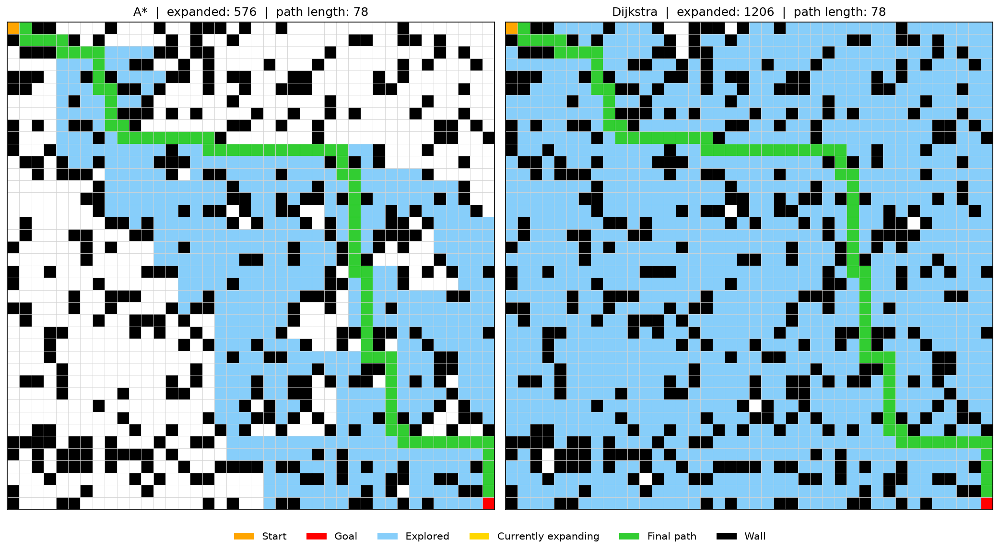

# Heuristic Graph Pathfinding: A* vs Dijkstra
A small Python project that compares **A\*** and **Dijkstra's algorithm** on grid mazes, and lets you actually *watch* them search.
Both algorithms always find the shortest path. The interesting part is **how much of the maze each one has to explore to get there**. Dijkstra spreads out in every direction like a ripple. A* uses a heuristic to lean toward the goal, so it looks at far fewer cells.

## What it does
- Implements A* (Manhattan distance heuristic) and Dijkstra from scratch using a priority queue
- Generates random mazes of any size (10x10 up to 60x60), always solvable
- Shows a **static comparison** of explored cells and the final path
- Shows a **live animation**, including a side-by-side race between the two algorithms
- Benchmarks both algorithms and saves the numbers to a CSV

## Example result
On a random 25x25 maze:

| Algorithm | Path length | Nodes expanded |
|-----------|-------------|----------------|
| A*        | 50          | 169            |
| Dijkstra  | 50          | 440            |

Same path length, but A* searched about 60% fewer nodes.

## How to run
You need Python 3.10 or newer (3.12 works well).

bash
# 1. clone the repo
git clone https://github.com/YOUR_USERNAME/Heuristic-Graph-Pathfinding.git
cd Heuristic-Graph-Pathfinding

# 2. (optional) create a virtual environment
python -m venv .venv
.venv\Scripts\activate        # Windows
# source .venv/bin/activate   # macOS / Linux

# 3. install dependencies
pip install -r requirements.txt

# 4. start the interactive menu
python -m src.visualize

Run these from the project's root folder, not from inside `src/`.

### The menu
You first pick a maze (random or the small sample one), then:

1) Static - A* only
2) Static - Dijkstra only
3) Static - A* vs Dijkstra side by side
4) LIVE   - A* only
5) LIVE   - Dijkstra only
6) LIVE   - A* vs Dijkstra race
7) New maze
0) Quit

In the live views:

- light blue = cells already explored
- gold = the cell being expanded right now
- green = the final shortest path
- orange / red = start / goal

You can also choose the animation speed. For bigger mazes, a higher speed keeps things smooth.

### Just the numbers
bash
python -m src.benchmark

This prints a comparison table in the terminal and writes `results/benchmark_results.csv`.

## Project structure

Heuristic_Graph_Pathfinding/
├── src/
│   ├── astar.py        # A* search
│   ├── dijkstra.py     # Dijkstra search
│   ├── maze.py         # maze loading + random maze generator
│   ├── benchmark.py    # runtime / expanded nodes comparison
│   └── visualize.py    # interactive menu, static and live views
├── mazes/
│   └── sample_maze.txt # small hand-made maze (S = start, G = goal, # = wall)
├── results/            # saved images and benchmark CSV
└── requirements.txt

## Using your own maze
Edit `mazes/sample_maze.txt` (or add a new file). Use `#` for walls, `.` for open cells, `S` for the start and `G` for the goal:

S..#.
##.#.
.....
.###.
....G

## How the two algorithms differ
Both pick the next cell from a priority queue, but they rank cells differently:

- **Dijkstra** ranks by the cost so far, `g(n)`. It has no idea where the goal is, so it explores everything closer than the goal first.
- **A\*** ranks by `g(n) + h(n)`, where `h(n)` is the Manhattan distance to the goal. Cells that point toward the goal get explored first.

Because the Manhattan distance never overestimates on a 4-direction grid, A* is still guaranteed to find the shortest path.

On very tight, winding mazes with only one possible route, the two behave almost the same. A* really pays off in open spaces.

## Built with
- Python
- Matplotlib (visualization and animation)
